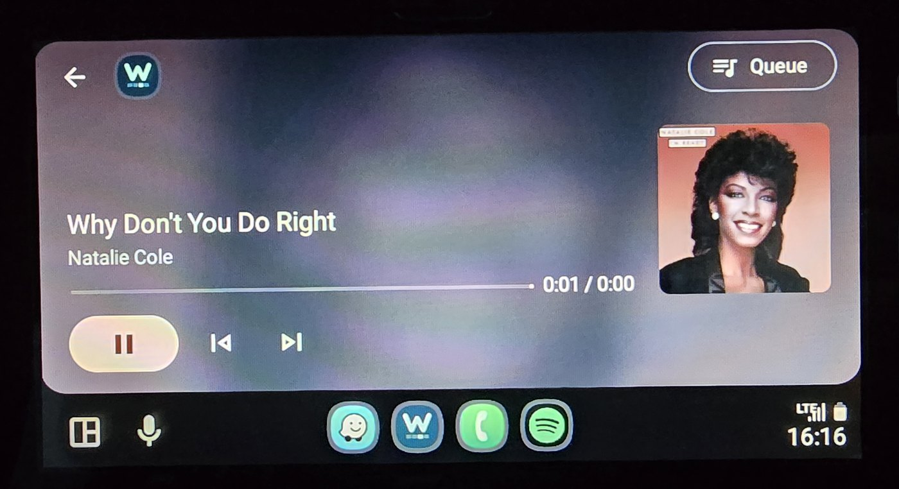
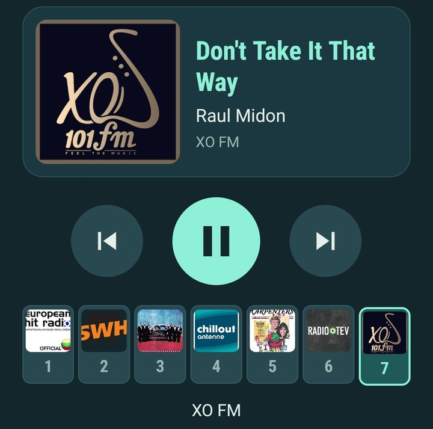

# Car Remote for WiiM

**Control your WiiM's presets from the Android Auto screen, even when the WiiM is on your phone's hotspot.**



A WiiM streamer connected to a car DSP over optical is a great way to get clean digital audio in a car.
Controlling it while driving is the hard part. This small Android app puts your WiiM presets where they
belong: on the car screen.

> Unofficial community project. Not made by, endorsed by, or affiliated with WiiM or Linkplay.

## The problem

In a car, the WiiM usually gets internet from the phone's Wi-Fi hotspot. That creates two problems:

- **The WiiM Home app could not control the WiiM from the same phone that was running the hotspot.**
- **There is no WiiM control inside Android Auto**, so changing a station means picking up the phone.

## The solution

Car Remote for WiiM talks directly to the WiiM's local HTTP API and appears as a normal media app in Android Auto.

```text
Phone hotspot ──── internet ───► WiiM ── optical ──► car DSP ──► speakers
      │                           ▲
      └── Car Remote for WiiM ────┘
          commands only, no audio through the phone
```

The phone only sends commands, so the music never passes through it. While Android Auto is connected, the app
plays inaudible noise (about -84 dBFS) on the phone, because Android only sends steering wheel buttons to an app that
is playing audio, and pure digital silence did not make the car switch to Android Auto. This signal goes through
Android Auto to the car's head unit. It is not sent to the WiiM and is not part of the WiiM's optical output.

## Features

- Browse and play your WiiM presets from Android Auto
- Play, pause, next and previous from the car screen and steering wheel
- WiiM volume - and + buttons on the Android Auto player
- Station name, current song, artwork and stream format
- Sound tab in Android Auto for volume and EQ presets
- Info tab in Android Auto with stream, Wi-Fi, network and device details
- Finds the WiiM automatically, with a countdown while it joins the hotspot
- Phone remote with presets, volume, EQ, audio output and Fixed Volume
- Works alongside Spotify Connect from the official Spotify app
- Connection test for checking the network from the driver's seat
- Quiet left/right test sound at 96 kHz / 24-bit
- Local debug log for troubleshooting in the car, kept for 3 days



## Current limitations

- **Steering wheel volume controls the car, not the WiiM.** Next, previous and play/pause go to the WiiM.
  Use the - and + buttons on the Android Auto player for WiiM volume. They respond with a small delay.
- **Fixed Volume uses an undocumented WiiM command.** Turning it on jumps the WiiM to 100%, so turn your DSP down first.
  A future firmware update could change this command.
- **Presets only.** You can play the presets saved on the WiiM, but not browse services, playlists or albums.
- **Initial setup needs the WiiM Home app on your home network.** Presets and Wi-Fi are configured there first.
- **Some stations may stall over mobile data.** In testing, a few radio presets stayed in loading while others
  started normally. The cause is still unknown.
- **Android only.** CarPlay and iPhone are not supported.
- **The Android Auto queue can still jump.** It can return to the top after about 2 seconds during playback.
- **Starting the car can switch it from FM to Android Auto audio** when the WiiM is on, so the steering wheel works.
- **Lightly tested.** It has only been used on the setup below.

## Tested setup

| Part | Used for testing |
| --- | --- |
| Car | Suzuki Vitara 2020 |
| Streamer in the car | WiiM Mini, optical output |
| Car DSP | HELIX M FOUR DSP |
| Phone | Samsung Galaxy S24 Ultra |
| Android Auto | Wireless adapter, with the phone's hotspot running at the same time |
| Also tested | WiiM Pro, API and phone remote on a home network |

## Setup

### 1. Prepare the WiiM at home

In the **WiiM Home** app, on your home network:

1. Save your favourite stations as presets.
2. Set the output for your car. For a DSP, use fixed volume and turn EQ off.
3. Limit the maximum sample rate to what your DSP's optical input accepts. Many car DSPs stop at 96 kHz.
4. Connect the WiiM to your phone's hotspot.

**Tip:** give your phone's hotspot the same name and password as your home Wi-Fi. The WiiM can then join
either network without being reconfigured. A 2.4 GHz hotspot is the safest choice.

### 2. Install the app

Download the APK from the [latest release](https://github.com/jozhix/car-remote-for-wiim/releases/latest) and open
it on your phone. Android will ask you to allow installing apps from your browser or file manager.

### 3. Allow it in Android Auto

Android Auto hides apps that were not installed from Google Play until you allow them:

1. Open **Android Auto settings** and tap **Version and permission info** 10 times.
2. Open the three-dot menu, then **Developer settings**.
3. Enable **Unknown sources**.
4. If the app is missing from the car screen, check **Customize launcher**.

### 4. First run in the car

1. Turn on the hotspot and power the WiiM.
2. Open **Car Remote for WiiM** on the phone. It searches for your WiiM on first launch.
3. Turn the car volume down and tap **Play test sound**. You should hear a low tone on the left, then a
   higher tone on the right.
4. Open the app on the Android Auto screen and pick a preset.

### Start the hotspot automatically

Android does not allow normal apps to turn on the internet hotspot, but Samsung phones can do it with a routine.
Wireless Android Auto starts with a Bluetooth connection, so that connection makes a good trigger:

1. Connect to your car once, so its Bluetooth device is known to the phone.
2. Open **Settings > Modes and Routines > Routines** and tap **+**.
3. Under **If**, add **Bluetooth device** and choose your car or wireless Android Auto adapter, whichever
   connects every time you start the car.
4. Under **Then**, add **Connections > Mobile Hotspot** and set it to **On**.
5. Save the routine with a name such as **Car hotspot**.
6. Keep the option that reverses the routine's actions when it ends, so the hotspot turns off when you leave the car.
7. Start the car and check that the hotspot turns on and the WiiM joins it.

Menu names can vary between One UI versions. If the routine stops working after a software update, open it and
save it again, or recreate it. On other Android phones, look for a similar built-in automation feature.

## Privacy

The app has no accounts, analytics or ads. It talks to your WiiM on the local network and downloads station
artwork from the addresses your WiiM provides.

The debug log stays on your phone, and logs older than 3 days are deleted automatically. It is only sent
if you tap **Share debug log**. It contains local IP addresses, device names and station names, so review it
before posting it publicly.

## Build from source

Requires JDK 17 and the Android SDK (platform 35).

```powershell
.\gradlew.bat testDebugUnitTest assembleDebug
```

On macOS or Linux, use `./gradlew`. The APK is written to `app/build/outputs/apk/debug/app-debug.apk`.

To include a read-only test against a real device, add `-Pwiim.host=<wiim-ip>`.

## Contributing

Issues and pull requests are welcome. The most useful contributions right now are test reports from other
phones, cars and WiiM models. Please remove private details from any debug log you attach.

## Background and credits

This started years ago as a small web page for sending commands to a WiiM Mini in a car. It was abandoned
because it never worked from the Android Auto interface, then finally became a real app with the help of
[Claude Code](https://claude.com/claude-code).

If you are curious about using a WiiM in a car, watch RAW-CAt's video:
[WiiM Pro Plus - stream lossless in a car!](https://www.youtube.com/watch?v=agFGyObEoX8)

## License

[MIT](LICENSE)
